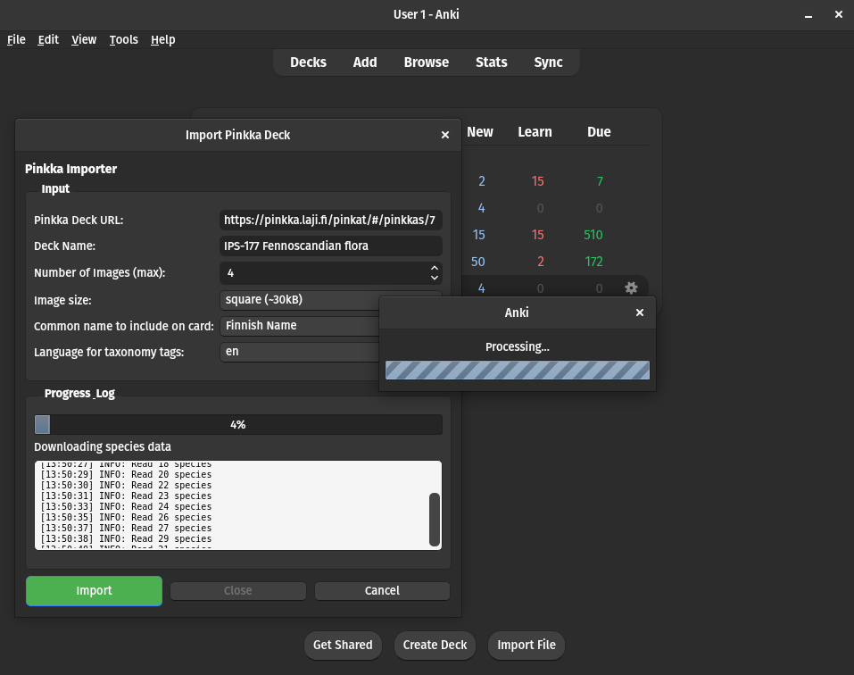
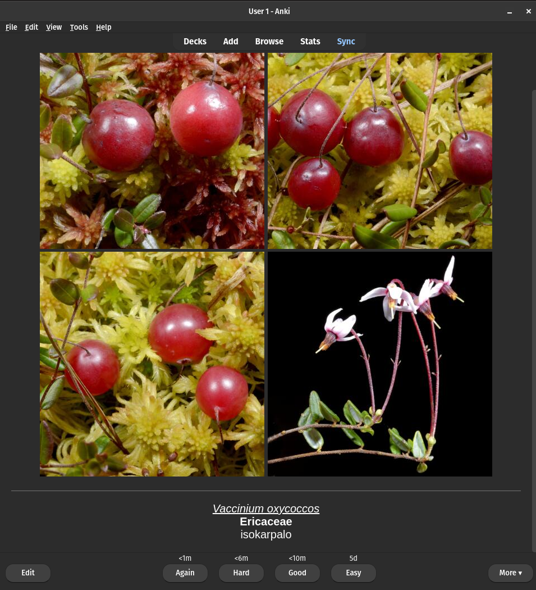

# Anki Pinkka Importer

An Anki addon to convert plant image collections from [Pinkka](https://pinkka.laji.fi) to an Anki deck. Pinkka is a platform used by the University of Helsinki (and other Finnish organizations) for plant identification lessons. This set of functions can be used to collect data from Pinkka's API and convert them into Anki flashcards. Specifically it's useful for students who need to memorize scientific names before a test.

I have been studying Finnish plants using Pinkka, but I thought it would be useful to have the spaced repetition from Anki, plus the ability to organize the cards by family or other categories.

The Anki deck that is created will have your desired number of images on the front of the flashcard, then the given scientific name, family and common name on the back. The scientific name is also a hyperlink to the source Pinkka page. You can customize the cards once you add them to Anki, including adding to the Notes field which will display at the end, or changing the images.

This is a distinct iteration on [Pinkka2Anki](https://github.com/north-ross/pinkka2anki), adapting it to work as an Anki addon instead of a Python tool to package a .apkg file (which used GenAnki instead of the native libraries).

Please raise an issue on the [GitHub page](https://github.com/north-ross/Anki-Pinkka-Importer/issues) if you have any feedback or suggestions.

# Use
1. After installing (follow the instructions [here](https://ankiweb.net/shared/info/1934767559)), select "Import Pinkka Deck" from the "Tools" menu in the upper left.
2. Paste the URL to the Pinkka collection in the first box, and enter an appropriate deck name in the next one. Note that if you enter the name of an existing deck, it will be updated with any new cards from your query.
3. Select any additional options. 
    - I find that the default options (four cards at the "square" size) is sufficient for studying, although some will need to be manually edited. See my Studying Tips below.
    - When choosing a common name, the selected option will display on the card, but all three languages will be saved in the note. You can edit your note template to change this later, or include multiple languages. Note that most collections don't have an English name available, and some taxa have no common names at all.
    - If you have already imported some notes and are having issues with fields not importing, try deleting the note type from the Browse window.
4. Click "Import" and your deck should be created. Downloading a large collection could take up to ten minutes depending on your configuration.

 </img>     </img>

## My Studying Tips
- Use the tags on the cards like family and sub-pinkka for [Custom Study](https://docs.ankiweb.net/filtered-decks.html?highlight=filtered%20deck#custom-study). You can also add your own tags, like "small-white-flower" or "aquatic" for example, to help with comparing different ones. 
    - Don't rely on this too much, since Anki works best by using large decks with a variety of terms to help your memory.
- Sometimes the images downloaded by the script will be missing an important ID feature. You can click on the scientific name to visit the Pinkka page and see all the images, then download a better one and edit the card to add it. Adding notes and customizing your cards is a good way to learn.
    - Note that the exams for IPS-153 and 177 will usually only show **one** photo for each species, so try to avoid relying on only one of the images for ID. Studying with the actual Pinkka test once you're familiar with the species will let you see all the photos.
- You can sync to your Anki account and use the app to study on your phone. It's free on Android but the official iOS app is a bit expensive, although there are some free forks of it.

# Dependencies
- Python 3.4+
- `requests` (`pip install requests`)
- `anki`/`aqt` (packaged with Anki)

# Notes
If you have found this useful this consider donating to the free and open source software [Anki](https://apps.ankiweb.net/).

Some was code adapted from [Anki Quizlet Importer Extended](https://github.com/sviatoslav-lebediev/anki-quizlet-importer-extended).

Some code advice came from [duck.ai](https://duck.ai) (Claude Haiku 4.5), but no AI-generated code was used.

A future update could add an option to keep the learning progress of a species when importing a new deck that contains the same species (e.g. IPS-153 and IPS-177 have some overlap)
